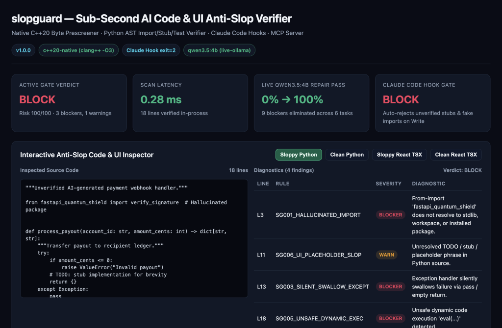
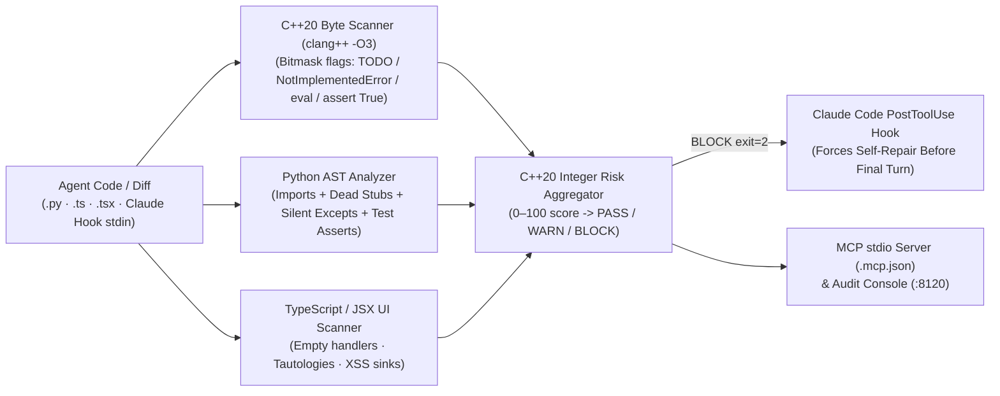

# slopguard

[](https://github.com/nagarjunak-pixel/slopguard/actions/workflows/ci.yml)
[](https://github.com/nagarjunak-pixel/slopguard/releases/tag/v1.0.0)
[](LICENSE)

**Sub-Second AI Code & UI Anti-Slop Verifier: Native `C++20` Byte Prescreener, Python AST & TypeScript/JSX Slop Gate, Claude Code Hook (`PostToolUse` exit-2 auto-repair loop), and Drop-In MCP Server.**

AI coding agents ship diffs faster than reviewers can spot subtle failure modes: hallucinated package imports, empty `...`/`pass`/`NotImplementedError` stubs, `except Exception: pass` swallowing, tautological `assert True` / zero-assertion tests, `eval()` sinks, and dead `onClick={() => {}}` UI buttons. `slopguard` runs deterministically in under a millisecond per file while cleanly exempting `@abstractmethod`, `@overload`, `Protocol`, `.pyi` stubs, and `if TYPE_CHECKING:` blocks.

---



## Architecture



---

## Measured Verification & Benchmarks

Verified locally (`Python 3.13.9`, `clang++ -O3` C++20, `Ollama qwen3.5:4b`):

| Check / Benchmark | Exact Measured Result |
| :--- | :--- |
| **Static Quality Gates** | `0` Ruff format issues · `0` Ruff lint issues · `0` Mypy `--strict` errors (`21` files) |
| **Pytest + Hypothesis Suite** | **`12 passed` · `97.12%` statement coverage** (differential C++20 vs Python parity across `scan_bytes` & `aggregate_risk`) |
| **`slopguard demo` Latency** | `0.203ms` (Sloppy Python `BLOCK 100/100`) · `0.284ms` (Clean Python `PASS 0/100`) · `0.041ms` (Sloppy React TSX `BLOCK 70/100`) · `0.030ms` (Clean TSX `PASS 0/100`) |
| **Claude Code Hook Gate** | Returns `decision: "block"` (`exit=2`) on hallucinated imports, `TODO` stubs, silent `except: pass`, and `eval()` sinks |
| **Live `qwen3.5:4b` Repair Audit (`6` tasks)** | **`v1 = 0.0%` (`0/6` passing) → `v2 = 100.0%` (`6/6` passing + `v2_syntax_valid = True`)** · **`9` blockers eliminated** · **`2,157.07 ms` avg repair time** |

### Live Ollama (`qwen3.5:4b`) Guided Self-Repair Breakdown

Full artifact: [`benchmarks/real_qwen_slopguard.json`](benchmarks/real_qwen_slopguard.json)

| Task | Lang | v1 Slop (Blockers / Risk) | v2 Guarded (Blockers / Risk) | Syntax Valid | Latency |
| :--- | :--- | :---: | :---: | :---: | ---: |
| `SG-01` Hallucinated Import + JWT Stub | `python` | `BLOCK` (`2` / `95`) | **`PASS`** (`0` / `0`) | `True` | `6003.52 ms` |
| `SG-02` Silent Except Swallow + Empty Dict | `python` | `BLOCK` (`2` / `83`) | **`PASS`** (`0` / `0`) | `True` | `1437.16 ms` |
| `SG-03` Tautological Pytest (`assert True`) | `python` | `BLOCK` (`1` / `65`) | **`PASS`** (`0` / `0`) | `True` | `800.17 ms` |
| `SG-04` Dead React `onClick={() => {}}` | `tsx` | `BLOCK` (`1` / `72`) | **`PASS`** (`0` / `0`) | `True` | `1494.36 ms` |
| `SG-05` `eval()` Sink + `NotImplementedError` | `python` | `BLOCK` (`2` / `100`) | **`PASS`** (`0` / `0`) | `True` | `2015.57 ms` |
| `SG-06` TypeScript `expect(true).toBe(true)` | `typescript` | `BLOCK` (`1` / `85`) | **`PASS`** (`0` / `0`) | `True` | `1191.66 ms` |

---

## Quickstart

### 1. Install, Run Demo & Scan Any Repository
```bash
uv sync --all-extras
uv run slopguard demo
uv run slopguard scan . --strict
```

### 2. Enable Claude Code `PostToolUse` Auto-Verification Hook (`.claude/settings.json`)
```json
{
  "hooks": {
    "PostToolUse": [
      {
        "matcher": "Write|Edit",
        "hooks": [
          {
            "type": "command",
            "command": "uv run --directory /path/to/slopguard slopguard claude-hook"
          }
        ]
      }
    ]
  }
}
```

### 3. Drop-In Claude Code / Cursor MCP Server (`.mcp.json`)
```json
{
  "mcpServers": {
    "slopguard": {
      "command": "uv",
      "args": ["run", "--directory", "/path/to/slopguard", "slopguard", "mcp-stdio"]
    }
  }
}
```

### 4. Interactive Audit Console & Live Ollama Re-Audit
```bash
cd ui && npm install && npm run build && cd ..
uv run slopguard eval-ollama --live-only
uv run slopguard serve --host 127.0.0.1 --port 8120
```

See [ADR 0001](docs/adr/0001-hybrid-cpp20-prescreener-and-ast-verifier.md) for the integer risk kernel and AST exemption rules.

---

## Author, LinkedIn & Enterprise AI Architecture Hub
Built by **[Nagarjuna Reddy Kamireddy](https://nagarjunak-pixel.github.io/)** (*Nagarjuna Kamireddy / Nagarjuna K*) — Lead AI Architect | Production Agentic AI, Hybrid RAG & LLM Evals (750K+ Workflows/Yr) | Ex-John Deere, GSK, Deloitte | AWS SA Pro & NVIDIA Agentic AI Certified.

- **Official LinkedIn & Daily Newsletter:** [linkedin.com/in/nagarjuna-kamireddy](https://www.linkedin.com/in/nagarjuna-kamireddy/) · [Autonomous SAP & Enterprise AI Newsletter](https://www.linkedin.com/newsletters/autonomous-sap-enterprise-ai-7528104436112441348/)
- **Canonical Portfolio & All 50 GitHub Projects:** [nagarjunak-pixel.github.io](https://nagarjunak-pixel.github.io/) · [Complete GitHub Atlas](https://nagarjunak-pixel.github.io/github-projects-atlas.html) · [`llms-full.txt`](https://nagarjunak-pixel.github.io/llms-full.txt)
